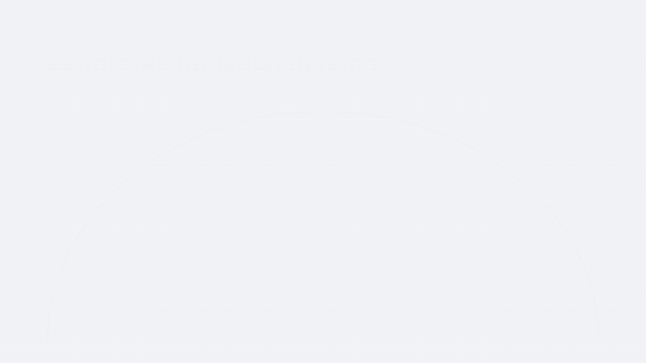
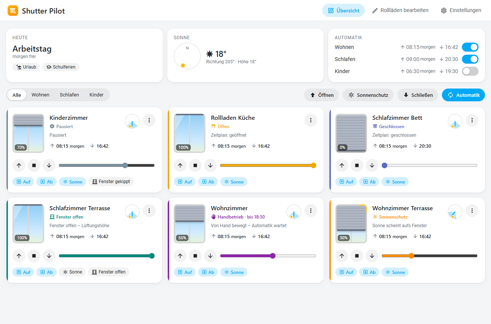
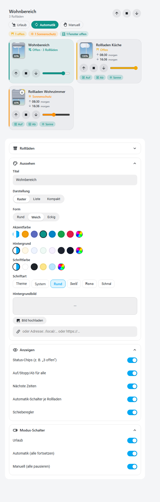
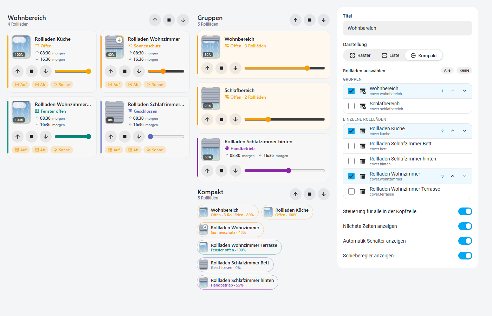

# Shutter Captain – Rollladensteuerung für Home Assistant

Automatische Steuerung von Rollläden, Jalousien und Markisen: Zeitprofile, Sonnenauf- und
-untergang, Golden Hour, Sonnenschutz nach Sonnenstand und Temperatur, Fensterkontakte mit
Aussperrschutz, Alarme (Feuer, Regen, Wind, Frost), Feiertage und Urlaub – alles in einem
eigenen Panel in der Seitenleiste einstellbar.

Inspiriert vom ioBroker-Adapter *shuttercontrol*, nativ für Home Assistant neu gebaut.

[](https://github.com/Fab29-690/ha-shutter-captain/blob/main/docs/video/shutter-captain.mp4)

▶️ **[Erklärvideo ansehen (65 Sekunden)](https://github.com/Fab29-690/ha-shutter-captain/blob/main/docs/video/shutter-captain.mp4)**



## Funktionen

- **Drei Bereiche** (Wohnen, Schlafen, Kinder) mit Zeiten für Arbeitswoche und Wochenende/Feiertag.
  Pro Bereich: *nur Zeit*, *Sonnenauf-/-untergang* oder *Golden Hour* – immer begrenzt durch
  früheste/späteste Öffnung und spätestes Schließen. Freitag schließt mit Wochenendzeit, Sonntag mit Wochenzeit.
- **Pro Rollladen** getrennt für Öffnen und Schließen: Bereich, Bereich mit Automatik-Schalter,
  Sonnenauf-/-untergang, Sonnenhöhe, Golden Hour, Helligkeitssensor oder nur manuell.
- **Sonnenschutz** nach Sonnenstand (Fensterausrichtung ± Bereich), Außen-/Innentemperatur und
  Lichtsensor (UND-verknüpft, mit Hysterese), Ende unter Sonnenhöhe, *halten bis abends*,
  Verzögerung, Hitzeschutz und **Lamellenwinkel** für Jalousien.
- **Fenster & Tür**: offen/gekippt, Lüftungshöhen, Fahren bei Öffnen/Schließen, **Aussperrschutz**,
  erst schließen und dann auf Lüftungshöhe, Nachfahren nach dem Schließen, Verzögerungen.
- **Alarme**: Feuer (bleibt verriegelt, bis „Alle öffnen/schließen“ gedrückt wird), Regen, Wind 1/2, Frost.
  Frost auch per Temperatur – mit **Frost-Öffnungshöhe** und **Frostsperre** (festgefroren: keine automatische Fahrt).
- **Stufen**: Schließstufe 1 per Entität, Schließstufe 2 (Nacht) per Helligkeit, Uhrzeit und/oder Entität
  mit UND/ODER – nur nach vollständigem Schließen. **Öffnungsstufe 2**: morgens erst Teilhöhe, später ganz.
- **Sichtschutz** und **My-Position** je Rollladen als Knopf, Dienst und in Panel und Karte;
  **Insektenschutz**: einmal am Tag kurz ganz hoch und zurück.
- **Gerätetypen**: Rollläden/Jalousien, Markisen, Garagentore/Tore und **Dachfenster** (schließen bei
  Regen/Wind, automatisch nach X Minuten und abends, Lüften) – jeweils mit eigenen Einstellungen und Symbol.
- **Plausibilitäts-Hinweise** im Panel bei widersprüchlichen oder wirkungslosen Einstellungen.
- **Kalender**: Workday-Sensor (Feiertage), Arbeitstag morgen, Urlaub, Schulferien je Bereich,
  Sommer (nicht schließen), Weihnachtshöhe, spät schließen, Zwischenposition.
- **Handbetrieb-Erkennung** mit Rundung auf bekannte Höhen; endet beim nächsten Zeitereignis,
  nach einer Dauer oder erst bei „Fortsetzen“.

### Neu in 2.6

- **Notfall-Eingang** (z. B. Rauchmelder): höchste Priorität, alle Rollläden auf Notfallposition, Markisen fahren ein.
- **Schließstufen**: Stufe 1 auch per Entität (z. B. Licht an), Stufe 2 für die Nacht mit eigener Höhe,
  Lamellenwinkel, Lux-Schwelle und Uhrzeit.
- **Zeitfenster für die Helligkeitssteuerung** (öffnet ab / schließt ab).
- **Reiter „Steuern“**: alle Rollläden, Markisen, Garagentore und Tore aus Home Assistant an einem Ort.

### Neu in 2.5

- **Mindestabstand zwischen allen Fahrbefehlen** – schont den Duty-Cycle von Homematic IP.
- **Sonnenschutz erst nach X Minuten** anhaltender Sonne, **Wettervorhersage** (Höchsttemperatur) und
  **Wetterlage** als Bedingung, **Monate** für den Sonnenschutz.
- **Hauptschalter** „Automatik (gesamt)“, **Anwesenheitssimulation** (zufällige Zeiten), **Lichtaktion**
  beim Schließen, **Lüften-Knopf**, **Lamellenwinkel** für Offen/Geschlossen, **Markisen-Modus**.
- **Eigene Bedingungen** (z. B. „abends nur halb schließen, wenn es heiß ist und jemand zu Hause ist“).
- Ereignis `shutter_captain_cover_moved` bei jeder automatischen Fahrt.

### Verbesserungen gegenüber ioBroker

- **Seitenleisten-Panel** mit Live-Ansicht: animierter Rollladen, Status, **Begründung**
  („Fenster offen – Aussperrschutz verhindert Fahrt“), nächste Zeiten, Sonnenkompass je Fenster.
- **Alle Rollläden in einer Tabelle bearbeiten**, duplizieren, löschen – und **Mehrfachbearbeitung**:
  mehrere Rollläden auswählen und eine Einstellung für alle gleichzeitig ändern.
- **Pause** für 1 h / 3 h / bis Fortsetzen (z. B. bei einer Party).
- **Lamellen nativ** statt zwei Einträge pro Jalousie.
- **Helligkeitssteuerung mit Schutz**: Dunkelheit schließt nur abends, Helligkeit öffnet nur
  morgens – jeweils erst nach einer Mindestdauer. Eine Gewitterwolke mittags schließt nicht das ganze Haus.

## Installation

**HACS (empfohlen):**

1. HACS öffnen, nach **Shutter Captain** suchen und *Herunterladen* klicken.
2. Home Assistant neu starten.
3. *Einstellungen → Geräte & Dienste → Integration hinzufügen → Shutter Captain*.

[](https://my.home-assistant.io/redirect/hacs_repository/?owner=Fab29-690&repository=ha-shutter-captain&category=integration)

Falls Shutter Captain in der HACS-Suche noch nicht auftaucht, als benutzerdefiniertes Repository hinzufügen:
HACS → ⋮ → *Benutzerdefinierte Repositories* → `https://github.com/Fab29-690/ha-shutter-captain`
(Typ *Integration*), danach weiter mit Schritt 1.

> **Umstieg von Shutter Pilot 1.x?** Das betrifft nur, wer die frühere Version *dieses* Projekts als
> benutzerdefiniertes Repository installiert hat (`Fab29-690/ha-shutter-pilot`, Domain `shutter_pilot`).
> Mit der gleichnamigen, davon unabhängigen Integration *Shutter Pilot* von fschubi aus dem HACS-Store hat
> das nichts zu tun – wer diese nutzt, lässt sie einfach installiert.
> Die Integration wurde umbenannt (neue Domain `shutter_captain`): das alte benutzerdefinierte Repository
> *Shutter Pilot* in HACS und den Eintrag unter *Geräte & Dienste* entfernen, Shutter Captain installieren
> und neu einrichten.

**Manuell:** `custom_components/shutter_captain` nach `config/custom_components` kopieren und neu starten.

## Einrichtung

1. In der Seitenleiste **Shutter Captain** öffnen.
2. *Einstellungen*: Zeiten der Bereiche prüfen, optional Workday-Sensor, Alarme, Helligkeitssensor.
3. *Rollläden bearbeiten → Rollladen hinzufügen*.

> **Positionen** wie in Home Assistant: `100 %` = ganz offen, `0 %` = geschlossen.

## Gruppen

Shutter Captain legt automatisch Gruppen-Geräte an (jeweils mit einem gleichnamigen Rollladen, den Alexa,
Google und Assist unter diesem Namen finden): **Wohnbereich**, **Schlafbereich**, **Kinderbereich**
(jeweils alle Rollläden, die das Zeitprofil des Bereichs nutzen) und **Alle Rollläden**. Sie zeigen die
mittlere Position und fahren alle Mitglieder gemeinsam (auf, zu, stopp, Position, Lamellen).
Wird eine Gruppe auf eine konfigurierte Höhe gefahren (z. B. ganz auf/zu), bleibt die Automatik aktiv;
bei anderen Positionen gehen die Rollläden in den Handbetrieb.

## Dashboard-Karte

Die Karte wird automatisch geladen – keine Ressource nötig. *Dashboard bearbeiten → Karte hinzufügen →
Shutter Captain*. Im Editor wählst du die Rollläden und Gruppen (oder „Alle Rollläden“), ordnest sie per
Maus an und stellst das Aussehen ein: Darstellung (Raster, Liste, Kompakt), Form, Akzent-, Hintergrund-
und Schriftfarbe, Schriftart, Hintergrundbild (hochladen oder Adresse, mit Abdunkeln), Status-Chips und
die Schalter Urlaub / Automatik / Manuell. Die Karte passt sich ihrer Breite an – vom Handy bis zum
großen Bildschirm.





Unter *Einstellungen → Darstellung* wählst du die Akzentfarbe und eine Wetter-Entität – dann zeigen
Fenster in Panel und Karte Tageszeit, Wolken, Regen oder Schnee. Darstellung *Kompakt* zeigt jeden
Rollladen als kleinen Chip (antippen öffnet die Steuerung).

### Zwei Karten

- **Shutter Captain** – die ganze Übersicht (startet mit allen Rollläden), ideal als volle Karte.
- **Shutter Captain – Rollladen** – ein einzelner Rollladen oder eine Gruppe, passend für Abschnitte.

Wird ein Rollladen von Hand heruntergefahren, während seine Tür offen ist (Aussperrschutz), fragt die Karte vorher nach.

## Dienste

```yaml
action: shutter_captain.command          # open | close | sun_protect | auto
data: { action: close, area: living }  # all | living | sleep | children

action: shutter_captain.pause
data: { entity_id: cover.wohnzimmer, minutes: 120 }

action: shutter_captain.resume
data: { entity_id: cover.wohnzimmer }

action: shutter_captain.privacy         # Sichtschutz (oder: shutter_captain.my_position)
data: { entity_id: cover.wohnzimmer }   # override_lockout: true nur nach Rückfrage
```

## Projekt unterstützen

Shutter Captain ist und bleibt kostenlos. Alle Funktionen stehen allen uneingeschränkt zur
Verfügung – keine Bezahlversion, keine gesperrten Funktionen.

Wenn dir die Integration den Alltag ein wenig angenehmer macht und du Danke sagen möchtest, kannst
du die Weiterentwicklung mit einer völlig freiwilligen Spende unterstützen:

[](https://www.paypal.com/donate/?hosted_button_id=MJXKHUFM5M7ZQ)

Ein ⭐ auf GitHub, ein Fehlerbericht oder eine Idee in den Issues hilft genauso. Danke!

## Lizenz

Copyright (C) 2026 Fab29-690

Shutter Captain ist freie Software unter der [GNU General Public License v3.0](LICENSE). Du darfst
sie nutzen, weitergeben und verändern – veränderte Versionen müssen aber ebenfalls unter der GPL-3.0
mit offenem Quellcode veröffentlicht werden. Es gibt keine Gewährleistung.

Versionen bis einschließlich 3.2.0 wurden unter der MIT-Lizenz veröffentlicht.
