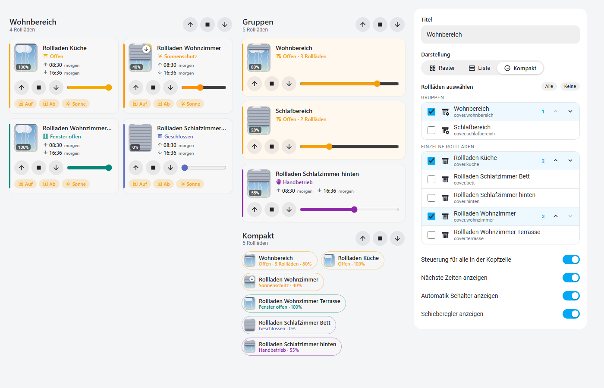

# Shutter Captain

[](https://hacs.xyz)
[](https://github.com/Fab29-690/ha-shutter-captain/actions/workflows/validate.yml)

**Automatic shutter, blind and awning control for Home Assistant** – time profiles, sunrise/sunset,
golden hour, sun protection by sun position and temperature, window contacts with lockout
protection, alarms (fire, rain, wind, frost), holidays and vacations – all configured in a
dedicated sidebar panel.

Inspired by the excellent ioBroker adapter *shuttercontrol*, rebuilt natively for Home Assistant.

🇩🇪 [Deutsche Anleitung](README.de.md)

[](https://github.com/Fab29-690/ha-shutter-captain/blob/main/docs/video/shutter-captain.mp4)

▶️ **[Watch the explainer video (65 s, German captions)](https://github.com/Fab29-690/ha-shutter-captain/blob/main/docs/video/shutter-captain.mp4)**


## Features

| | |
|---|---|
| **Time profiles** | Three areas (living, sleeping, children) with workday and weekend times. Fixed time, sunrise/sunset or golden hour, always limited by an earliest/latest opening and a latest closing time. Friday closes with weekend time, Sunday with workday time. |
| **Per shutter** | Open and close independently by area, area *with* auto switch, sunrise/sunset, sun elevation, golden hour, brightness sensor or manual only. Own open/closed positions. |
| **Sun protection** | By sun position (window orientation ± range), outside temperature, inside temperature and/or light sensor, AND-combined, with hysteresis. Ends below a configurable sun elevation. Keep-until-evening, end delay and heat protection. **Slat tilt** for venetian blinds. |
| **Window & door** | Open/tilt contact, vent positions, move on open/close, *lockout protection* (which direction may move while the door is open), close-then-vent, catch up after closing, delays. |
| **Alarms** | Fire (latched – escape routes stay open until released), rain, wind 1/2, frost – per shutter selectable, with priorities. |
| **Calendar** | Workday sensor (holidays), workday tomorrow, vacation switch/entity, school holidays per area, summer period (don't close), Christmas position, late close, intermediate position. |
| **Manual detection** | Moving a shutter by hand pauses its automation. Moving it to a known position keeps automation active (with rounding). Ends at the next scheduled event, after a timeout or only on resume – your choice. |
| **Group commands** | Open / close / sun protection / resume for all or per area – as buttons, services and in the panel. |
| **Group devices** | One device per area plus *All shutters*, each with a cover named like the device – so Alexa, Google and Assist know it as "Living area". Average position, open/close/stop/position/tilt for every member at once. |

### Beyond the ioBroker adapter

- **Sidebar panel** with live view: animated shutter, state, *why* it is where it is, next open/close, sun compass per window.
- **Edit all shutters in one table**, duplicate, delete – and **bulk edit**: select several shutters and change a setting for all of them at once.
- **Pause** a shutter for 1 h / 3 h / until resumed (service `shutter_captain.pause`), e.g. for a party.
- **Native slat tilt** instead of two entries per blind.
- **Explainable**: every shutter exposes a `reason` attribute ("window open – lockout blocks the move").
- **Brightness control with guard**: darkness only closes in the evening and brightness only opens in the morning, after a minimum duration – passing clouds don't close the house.
- Manual mode can expire automatically.
- Diagnostics download, German and English translations, light and dark theme.

## Installation

### HACS (recommended)

1. Open HACS, search for **Shutter Captain** and click *Download*.
2. Restart Home Assistant.
3. *Settings → Devices & services → Add integration → Shutter Captain*.

[](https://my.home-assistant.io/redirect/hacs_repository/?owner=Fab29-690&repository=ha-shutter-captain&category=integration)

If Shutter Captain does not show up in the HACS search yet, add it as a custom repository:
HACS → ⋮ → *Custom repositories* → `https://github.com/Fab29-690/ha-shutter-captain`, type *Integration*,
then continue with step 1.

> **Coming from Shutter Pilot 1.x?** This only applies if you installed the earlier version of *this*
> project as a custom repository (`Fab29-690/ha-shutter-pilot`, domain `shutter_pilot`). It has nothing
> to do with the unrelated *Shutter Pilot* integration by fschubi in the default catalog – if you use
> that one, leave it alone.
> The integration was renamed (new domain `shutter_captain`): remove the old *Shutter Pilot* custom
> repository in HACS and its entry under *Devices & services*, install Shutter Captain and set it up again.

### Manual

Copy `custom_components/shutter_captain` into your `config/custom_components` folder and restart.

## Setup

1. Open **Shutter Captain** in the sidebar.
2. *Settings*: check the times of the three areas, and optionally pick a workday sensor
   ([Workday integration](https://www.home-assistant.io/integrations/workday/)), alarms and a brightness sensor.
3. *Edit shutters → Add shutter*: choose the cover, how it opens and closes, and optionally window contact and sun protection.

Everything can also be done in *Settings → Devices & services → Shutter Captain* (Configure = global settings, *Add shutter* / ⋮ *Reconfigure* = per shutter).

> **Positions** follow Home Assistant: `100 %` = fully open, `0 %` = closed.


## Dashboard card

The card is loaded automatically – no resource needed. *Edit dashboard → Add card → Shutter Captain*.
In its editor pick the shutters and groups (or *all shutters*), arrange them with the mouse and set the
look: layout (grid, list, compact), shape, accent/background/text colour, font, background image
(upload or URL, with darkening), status chips and the vacation / automatic / manual buttons. The card
adapts to its width – from phone to large screen.




Under *Settings → Appearance* pick the accent colour and a weather entity – windows in panel and
card then show the time of day, clouds, rain or snow. Layout *Compact* shows each shutter as a small
chip (tap opens the controls).

```yaml
type: custom:shutter-captain-card
title: Living area
entities: [cover.living_area, cover.kitchen]   # or all_shutters: true
layout: grid          # grid | list | chips
shape: soft           # rounded | soft | square
color: teal
font: rounded
show_vacation: true
```

## Entities

Hub device *Shutter Captain*

| Entity | Purpose |
|---|---|
| `switch.*_vacation`, `switch.*_school_holidays` | Use weekend times |
| `switch.*_auto_living_area` … | Area auto switch (for "… (auto switch)" modes) |
| `button.*_all_open` / `_close` / `_sun_protection`, per area | Group commands |
| `button.*_all_resume_automation` | Leave manual mode everywhere |
| `sensor.*_status` | Workday/day off/vacation/alarm, with sun and area times as attributes |
| `sensor.*_next_opening` … per area | Next open/close |

Per shutter: `sensor.<name>_automation_status` (with `reason`, `next_open`, `manual_until`, …),
next opening/closing, switches *Open automatically*, *Close automatically*, *Sun protection*,
button *Resume automation*.

## Event

Every automatic move fires `shutter_captain_cover_moved` with `entity_id`, `name`, `position`,
`previous_position`, `reason` and `area` – handy for notifications or a log book:

```yaml
triggers:
  - trigger: event
    event_type: shutter_captain_cover_moved
    event_data: { reason: alarm_wind1 }
```

## Services

```yaml
action: shutter_captain.command        # open | close | sun_protect | auto
data: { action: close, area: living }  # all | living | sleep | children

action: shutter_captain.pause
data: { entity_id: cover.living_room, minutes: 120 }   # omit minutes = until resumed

action: shutter_captain.resume
data: { entity_id: cover.living_room }

action: shutter_captain.vent          # move to the vent position
data: { entity_id: cover.living_room }
```

## Coming from ioBroker shuttercontrol

| ioBroker | Shutter Captain |
|---|---|
| `control.closeAll` / `openLiving` / `sunProtectSleep` … | Buttons on the hub device, service `shutter_captain.command` |
| `control.autoAll` | Button *All: resume automation* |
| `control.Holiday` / `schoolfree` | Switches *Vacation* / *School holidays* |
| `control.autoLiving` … | Switches *Auto living area* … |
| `shutters.autoUp/autoDown/autoSun.<name>` | Per-shutter switches |
| `shutters.autoState.<name>` | `sensor.<name>_automation_status` |
| Feiertage adapter | Workday integration |
| Two entries for height + slats | One shutter with *slat tilt in sun protection* |

## Support

Issues and ideas: [GitHub issues](https://github.com/Fab29-690/ha-shutter-captain/issues).
Please attach the diagnostics download (*Devices & services → Shutter Captain → ⋮ → Download diagnostics*).

## Support this project

Shutter Captain is and will remain free. Every feature is fully available to everyone – no paid
version, no locked functions, nothing you have to pay for.

If it makes your home a little more comfortable and you'd like to say thanks, you can support its
development with a completely voluntary donation:

[](https://www.paypal.com/donate/?hosted_button_id=MJXKHUFM5M7ZQ)

A ⭐ on GitHub, a bug report or an idea in the issues helps just as much. Thank you!

## License

MIT
