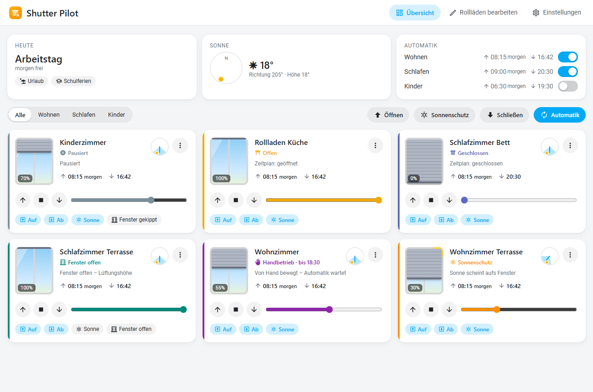
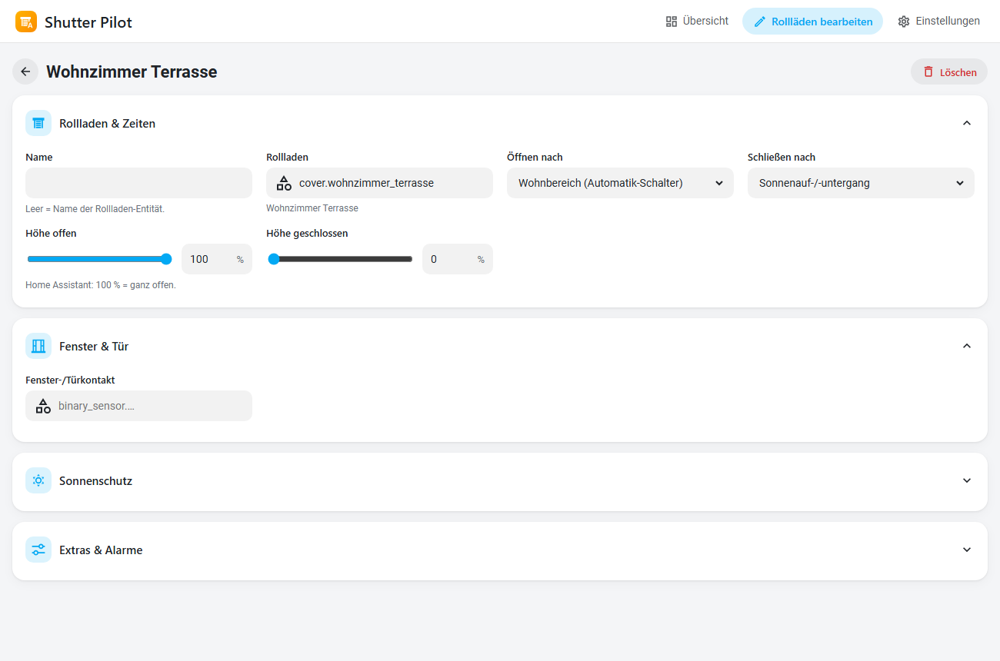

# Shutter Pilot

[](https://hacs.xyz)
[](https://github.com/Fab29-690/ha-shutter-pilot/actions/workflows/validate.yml)

**Automatic shutter, blind and awning control for Home Assistant** – time profiles, sunrise/sunset,
golden hour, sun protection by sun position and temperature, window contacts with lockout
protection, alarms (fire, rain, wind, frost), holidays and vacations – all configured in a
dedicated sidebar panel.

Inspired by the excellent ioBroker adapter *shuttercontrol*, rebuilt natively for Home Assistant.

🇩🇪 [Deutsche Anleitung](README.de.md)



## Features

| | |
|---|---|
| **Time profiles** | Three areas (living, sleeping, children) with workday and weekend times. Fixed time, sunrise/sunset or golden hour, always limited by an earliest/latest opening and a latest closing time. Friday closes with weekend time, Sunday with workday time. |
| **Per shutter** | Open and close independently by area, area *with* auto switch, sunrise/sunset, sun elevation, golden hour, brightness sensor or manual only. Own open/closed positions. |
| **Sun protection** | By sun position (window orientation ± range), outside temperature, inside temperature and/or light sensor, AND-combined, with hysteresis. Ends below a configurable sun elevation. Keep-until-evening, end delay and heat protection. **Slat tilt** for venetian blinds. |
| **Window & door** | Open/tilt contact, vent positions, move on open/close, *lockout protection* (which direction may move while the door is open), close-then-vent, catch up after closing, delays. |
| **Alarms** | Fire (latched – escape routes stay open until released), rain, wind 1/2, frost – per shutter selectable, with priorities. |
| **Calendar** | Workday sensor (holidays), workday tomorrow, vacation switch/entity, school holidays per area, summer period (don't close), Christmas position, late close, intermediate position. |
| **Manual detection** | Moving a shutter by hand pauses its automation. Moving it to a known position keeps automation active (with rounding). Ends at the next scheduled event, after a timeout or only on resume – your choice. |
| **Group commands** | Open / close / sun protection / resume for all or per area – as buttons, services and in the panel. |

### Beyond the ioBroker adapter

- **Sidebar panel** with live view: animated shutter, state, *why* it is where it is, next open/close, sun compass per window.
- **Edit all shutters in one table**, duplicate, delete – and **bulk edit**: select several shutters and change a setting for all of them at once.
- **Pause** a shutter for 1 h / 3 h / until resumed (service `shutter_pilot.pause`), e.g. for a party.
- **Native slat tilt** instead of two entries per blind.
- **Explainable**: every shutter exposes a `reason` attribute ("window open – lockout blocks the move").
- **Brightness control with guard**: darkness only closes in the evening and brightness only opens in the morning, after a minimum duration – passing clouds don't close the house.
- Manual mode can expire automatically.
- Diagnostics download, German and English translations, light and dark theme.

## Installation

### HACS (recommended)

1. HACS → ⋮ → *Custom repositories* → `https://github.com/Fab29-690/ha-shutter-pilot`, type *Integration*.
2. Install **Shutter Pilot**, restart Home Assistant.
3. *Settings → Devices & services → Add integration → Shutter Pilot*.

### Manual

Copy `custom_components/shutter_pilot` into your `config/custom_components` folder and restart.

## Setup

1. Open **Shutter Pilot** in the sidebar.
2. *Settings*: check the times of the three areas, and optionally pick a workday sensor
   ([Workday integration](https://www.home-assistant.io/integrations/workday/)), alarms and a brightness sensor.
3. *Edit shutters → Add shutter*: choose the cover, how it opens and closes, and optionally window contact and sun protection.

Everything can also be done in *Settings → Devices & services → Shutter Pilot* (Configure = global settings, *Add shutter* / ⋮ *Reconfigure* = per shutter).

> **Positions** follow Home Assistant: `100 %` = fully open, `0 %` = closed.



## Entities

Hub device *Shutter Pilot*

| Entity | Purpose |
|---|---|
| `switch.*_vacation`, `switch.*_school_holidays` | Use weekend times |
| `switch.*_auto_living_area` … | Area auto switch (for "… (auto switch)" modes) |
| `button.*_all_open` / `_close` / `_sun_protection`, per area | Group commands |
| `button.*_all_resume_automation` | Leave manual mode everywhere |
| `sensor.*_status` | Workday/day off/vacation/alarm, with sun and area times as attributes |
| `sensor.*_next_opening` … per area | Next open/close |

Per shutter: `sensor.<name>_automation_status` (with `reason`, `next_open`, `manual_until`, …),
next opening/closing, switches *Open automatically*, *Close automatically*, *Sun protection*,
button *Resume automation*.

## Services

```yaml
action: shutter_pilot.command        # open | close | sun_protect | auto
data: { action: close, area: living }  # all | living | sleep | children

action: shutter_pilot.pause
data: { entity_id: cover.living_room, minutes: 120 }   # omit minutes = until resumed

action: shutter_pilot.resume
data: { entity_id: cover.living_room }
```

## Coming from ioBroker shuttercontrol

| ioBroker | Shutter Pilot |
|---|---|
| `control.closeAll` / `openLiving` / `sunProtectSleep` … | Buttons on the hub device, service `shutter_pilot.command` |
| `control.autoAll` | Button *All: resume automation* |
| `control.Holiday` / `schoolfree` | Switches *Vacation* / *School holidays* |
| `control.autoLiving` … | Switches *Auto living area* … |
| `shutters.autoUp/autoDown/autoSun.<name>` | Per-shutter switches |
| `shutters.autoState.<name>` | `sensor.<name>_automation_status` |
| Feiertage adapter | Workday integration |
| Two entries for height + slats | One shutter with *slat tilt in sun protection* |

## Support

Issues and ideas: [GitHub issues](https://github.com/Fab29-690/ha-shutter-pilot/issues).
Please attach the diagnostics download (*Devices & services → Shutter Pilot → ⋮ → Download diagnostics*).

## License

MIT
